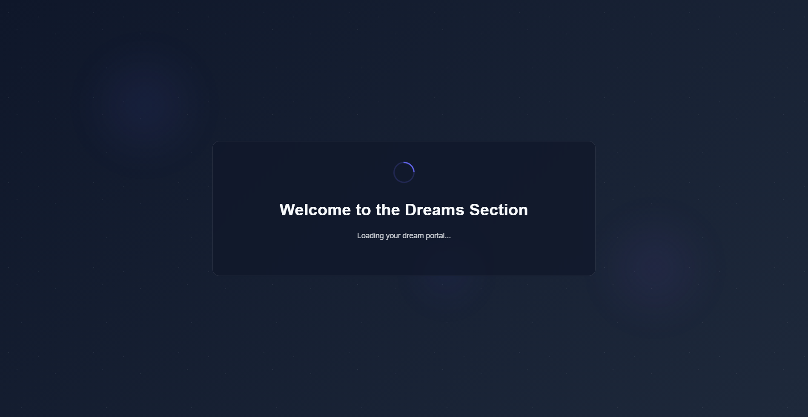
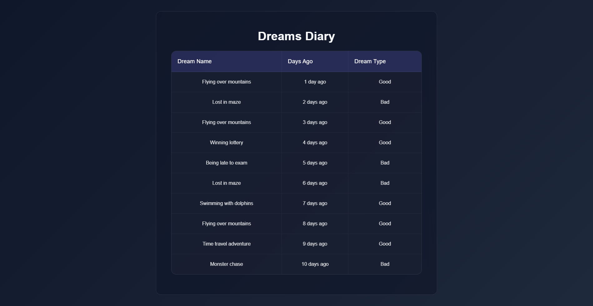

# Dream Portal — QA Automation Suite

Automated functional testing for the [Dream Portal](https://arjitnigam.github.io/myDreams/) dream
journalling site, built with **Selenium 4 + TestNG + Java 17** on the Page Object Model, with
reporting through **Allure** and a self-contained **Extent HTML** report.

Written for the Wingify QA Intern assignment. Part 1 (core UI automation) and Part 2 (AI-based
validation) are both implemented.

### Latest run

```
Tests run: 30, Failures: 0, Errors: 0, Skipped: 0
BUILD SUCCESS
```

30 tests across 4 classes, run headless against the live site — 17 UI tests plus 13 covering the AI
classification. The AI cross-check agreed with the portal on 10 of 10 dreams.

| | |
| --- | --- |
|  |  |
| The spinner captured on arrival, before the 3-second timeout fires | The ten-row dream log, every column populated |

---

## Contents

- [What is covered](#what-is-covered)
- [Tech stack](#tech-stack)
- [Project structure](#project-structure)
- [Getting started](#getting-started)
- [Running the tests](#running-the-tests)
- [Reports and logs](#reports-and-logs)
- [Part 2 — AI-based validation](#part-2--ai-based-validation)
- [Configuration](#configuration)
- [Design notes](#design-notes)
- [Continuous integration](#continuous-integration)

---

## What is covered

Every requirement in the assignment maps to a named test. The right-hand column is the method that
proves it.

### `index.html` — Dream Portal Home

| Requirement | Test |
| --- | --- |
| The loading animation appears | `loadingAnimationIsVisibleOnArrival` |
| …and disappears after ~3 seconds | `loadingAnimationDisappearsAfterAboutThreeSeconds` |
| The main content and "My Dreams" button become visible | `mainContentAndButtonBecomeVisibleAfterLoading` |
| Clicking "My Dreams" opens both pages in new tabs | `clickingMyDreamsOpensBothPagesInNewTabs` |
| *(added)* Both opened tabs actually render their tables | `tabsOpenedByTheButtonRenderTheirContent` |
| *(added)* The page is the one under test | `homePageHasExpectedTitle` |

### `dreams-diary.html` — Dream Log Table

| Requirement | Test |
| --- | --- |
| Exactly 10 dream entries | `diaryContainsExactlyTenEntries` |
| Dream types are only "Good" or "Bad" | `everyDreamTypeIsGoodOrBad` |
| Every row has all three columns filled | `everyRowHasAllThreeColumnsFilled` |
| *(added)* Column headers are correct | `diaryPageHasExpectedTitleAndHeaders` |
| *(added)* "Days Ago" is well formed and ordered newest first | `daysAgoValuesAreWellFormedAndSequential` |
| *(added)* The Good/Bad split is 6/4 | `dreamTypesSplitAsExpected` |
| *(added)* The recurring dreams are identified from the log itself | `recurringDreamsAreIdentifiedCorrectly` |

### `dreams-total.html` — Summary Page

| Requirement | Test |
| --- | --- |
| Good 6, Bad 4, Total 10, Recurring 2 | `summaryShowsExpectedStatistics` |
| "Flying over mountains" and "Lost in maze" are the recurring dreams, using the diary's logic | `recurringCountIsBackedByTheNamedDreams` |
| *(added)* Every summary figure is re-derived from the diary and compared | `summaryMatchesTheNumbersDerivedFromTheDiary` |
| *(added)* Good + Bad equals Total | `summaryTotalsAreInternallyConsistent` |
| *(added)* The page is the one under test | `summaryPageHasExpectedTitle` |

### Part 2 — AI validation

| Requirement | Test |
| --- | --- |
| Classify each dream name as Good/Bad with a model and assert against the table | `aiClassificationMatchesTheDiary` (runs once per dream) |
| *(added)* Overall agreement rate across all ten dreams | `aiAgreementRateMeetsTheThreshold` |
| *(added)* A blank dream name is rejected rather than guessed | `classifierRejectsAnEmptyDreamName` |

The tests marked *(added)* are not in the brief. They are there because they catch things the
listed checks cannot: `summaryMatchesTheNumbersDerivedFromTheDiary` in particular re-derives all
five statistics from the diary rows at runtime, so if the dream log ever changes, the summary page
is caught disagreeing with it instead of both being compared against the same stale constants.

---

## Tech stack

| Concern | Choice | Why |
| --- | --- | --- |
| Language | Java 17 | Records and text blocks keep the model and assertions readable |
| Browser automation | Selenium 4.49 | Selenium Manager resolves drivers, so no binaries are committed |
| Test runner | TestNG 7.12 | Groups, data providers, soft assertions, suite XML |
| Reporting | Allure 2.35 + Extent 5.1 | Allure for the step-level view, Extent for a single portable HTML file |
| Logging | Log4j2 2.26 | Console stays readable, the file keeps everything |
| HTTP / JSON | `java.net.http` + Jackson | The JDK client is enough; no extra HTTP dependency |
| Build | Maven 3.9 | The suite XML, the AspectJ weaver and the Allure plugin are all wired in `pom.xml` |

---

## Project structure

```
dream-portal-automation/
├── pom.xml                              Dependencies, Surefire suite wiring, Allure plugin
├── .env.example                         Template for API keys (.env itself is git-ignored)
├── .github/workflows/tests.yml          CI: runs the suite and publishes the reports
│
├── src/main/java/com/wingify/dreamportal/
│   ├── ai/                              Part 2 — pluggable dream classifiers
│   │   ├── DreamClassifier.java             Interface + result record + exception
│   │   ├── DreamClassifierFactory.java      Picks the provider, falls back to local rules
│   │   ├── AbstractHttpDreamClassifier.java Shared HTTP, retry and answer parsing
│   │   ├── OpenAiCompatibleDreamClassifier.java
│   │   ├── OpenAiDreamClassifier.java
│   │   ├── GroqDreamClassifier.java
│   │   ├── GeminiDreamClassifier.java
│   │   └── RuleBasedDreamClassifier.java    Local lexicon, needs no API key
│   │
│   ├── config/ConfigReader.java         System property > env > .env > config.properties
│   ├── driver/DriverFactory.java        ThreadLocal WebDriver, Chrome/Edge/Firefox
│   ├── listeners/                       Extent wiring, TestNG listener, retry
│   ├── model/                           DreamEntry record, DreamType enum
│   ├── pages/                           Page Object Model
│   │   ├── BasePage.java                    Waits and shared element helpers
│   │   ├── HomePage.java
│   │   ├── DreamsDiaryPage.java
│   │   └── DreamsTotalPage.java
│   └── utils/                           Screenshots, multi-tab handling, unified logging
│
├── src/test/java/com/wingify/dreamportal/tests/
│   ├── BaseTest.java                    One fresh browser per test method
│   ├── HomePageTest.java
│   ├── DreamsDiaryTest.java
│   ├── DreamsTotalTest.java
│   └── AiDreamClassificationTest.java
│
└── src/test/resources/
    ├── config.properties                All tunable values and expected data
    ├── log4j2.xml                       Console + rolling file appenders
    ├── testng.xml                       Full suite
    └── testng-smoke.xml                 Smoke subset
```

Page objects hold every locator and expose intent (`waitForLoadingAnimationToDisappear()`), never
raw `By` instances. A markup change is a one-file fix and no test is touched.

---

## Getting started

### Prerequisites

| Tool | Version | Notes |
| --- | --- | --- |
| JDK | 17 or newer | `java -version` |
| Maven | 3.8 or newer | `mvn -v` |
| Chrome | any recent | Or Edge/Firefox — pass `-Dbrowser=edge` |

No WebDriver binary needs to be downloaded: Selenium Manager fetches the matching driver on first
run.

### Install

```bash
git clone <this-repo-url>
cd dream-portal-automation
mvn clean test
```

That is the whole setup. The AI tests run out of the box using the local rule-based classifier;
see [Part 2](#part-2--ai-based-validation) to point them at a real model.

---

## Running the tests

```bash
# Everything — Part 1 and Part 2
mvn clean test

# Smoke subset only
mvn clean test -Dsuite=testng-smoke.xml

# Watch it happen in a real browser window
mvn clean test -Dheadless=false

# A different browser
mvn clean test -Dbrowser=edge
mvn clean test -Dbrowser=firefox

# Core UI only, skipping the AI part
mvn clean test -Dgroups=ui

# One class, or one method
mvn clean test -Dtest=DreamsDiaryTest
mvn clean test -Dtest=DreamsDiaryTest#diaryContainsExactlyTenEntries
```

---

## Reports and logs

After a run:

| Output | Path | How to open |
| --- | --- | --- |
| **Extent HTML report** | `target/reports/ExtentReport.html` | Open it in a browser — self-contained, screenshots embedded, nothing to install |
| **Allure report** | `target/allure-results/` | `mvn allure:serve` (downloads Allure automatically) or `mvn allure:report` |
| **Screenshots** | `target/screenshots/` | One per test, named `<method>_<outcome>_<timestamp>.png` |
| **Full log** | `target/logs/automation.log` | Every step, including the Selenium internals kept off the console |
| **Surefire output** | `target/surefire-reports/` | The raw TestNG XML/HTML |

Sample screenshots from a real run are committed under [`docs/screenshots/`](docs/screenshots/) so
the reports can be reviewed without running anything.

Logging goes to three places at once through `TestLog`: the console/file log, the Extent report and
the Allure timeline. That is deliberate — otherwise the HTML report ends up containing nothing but
pass/fail ticks.

---

## Part 2 — AI-based validation

Each of the ten dream names is sent to a language model with a single instruction — *answer with
one word, Good or Bad* — and the answer is asserted against the Dream Type column on the portal.

### Providers

The suite ships four implementations behind one `DreamClassifier` interface:

| `AI_PROVIDER` | Implementation | Key needed |
| --- | --- | --- |
| `rule` *(default)* | `RuleBasedDreamClassifier` — local keyword lexicon | none |
| `gemini` | Google Gemini | `GEMINI_API_KEY` |
| `groq` | Groq, serving open-source models such as Llama | `GROQ_API_KEY` |
| `openai` | OpenAI | `OPENAI_API_KEY` |

The default is `rule` so the suite is runnable — and deterministic — on a machine with no API key
and no network access to a model provider. It exercises exactly the same assertion path; only the
classifier behind the interface changes.

### Pointing it at a real model

```bash
cp .env.example .env
```

Then set two values in `.env`:

```ini
AI_PROVIDER=gemini
GEMINI_API_KEY=your-key-here
```

and run `mvn clean test`. `.env` is git-ignored, so a key cannot be committed by accident. The same
values can be supplied as ordinary environment variables instead, which is what CI does.

If a provider is selected but its key is missing, the factory logs a warning and falls back to the
local classifier rather than failing the run. Set `ai.fallback.to.rules=false` to make a missing key
an error instead.

### How disagreement is handled

`aiClassificationMatchesTheDiary` asserts each dream individually, so a mismatch names the dream and
both verdicts. `aiAgreementRateMeetsTheThreshold` then reports the agreement rate across all ten and
asserts it against `ai.minimum.agreement.ratio` (default `0.7`).

Both exist on purpose. Classifying "Winning lottery" by emotional tone is a judgement call, and a
model is entitled to disagree on a minority of entries; the aggregate rate is the number that says
whether the labelling and the model broadly agree, while the per-dream assertions are what make a
specific disagreement visible in the report.

---

## Configuration

Everything lives in [`src/test/resources/config.properties`](src/test/resources/config.properties).
No value needs editing to run the suite — each one can be overridden at the command line
(`-Dbrowser=edge`), as an environment variable (`BROWSER=edge`), or in `.env`.

| Key | Default | Meaning |
| --- | --- | --- |
| `base.url` | the GitHub Pages site | Application under test |
| `browser` | `chrome` | `chrome`, `edge` or `firefox` |
| `headless` | `true` | Set `false` to watch the run |
| `explicit.wait.seconds` | `15` | Ceiling for every wait |
| `loading.animation.min/max.seconds` | `1.5` / `6` | Tolerance around the advertised 3-second spinner |
| `expected.*` | 10 / 6 / 4 / 2 … | Expected data, kept out of the test bodies |
| `retry.count` | `1` | Re-runs of a failed test; `0` disables |
| `screenshot.on.success` | `true` | Capture on pass as well as on failure |
| `ai.provider` | `rule` | See [Part 2](#part-2--ai-based-validation) |
| `ai.minimum.agreement.ratio` | `0.7` | Agreement rate the AI cross-check must reach |

---

## Design notes

A few choices worth explaining, since they are the ones a reviewer would otherwise have to
reverse-engineer.

**The diary is the source of truth, not a list of constants.** The obvious way to test the summary
page is to assert `Good == 6`. That passes even if the diary changes underneath it, because nothing
connects the two pages. `summaryMatchesTheNumbersDerivedFromTheDiary` reads the ten rows, derives
all five statistics from them, and compares those with the summary. Both checks are kept: the
constants catch a regression against the specification, the derivation catches the pages drifting
apart.

**"Recurring" is computed, not hard-coded.** The portal's own definition — a dream name appearing in
more than one entry — is implemented in `DreamsDiaryPage.getRecurringDreamNames()`. The test then
asserts both that the two named dreams are in that set, and that the set contains nothing else, so
an unexpected duplicate would also be caught.

**Tabs are matched by URL, not by opening order.** The "My Dreams" button calls `window.open()`
twice. The order in which a browser reports window handles is not guaranteed to match the order the
tabs were opened, so `WindowManager` identifies each tab by the page it is showing. Chrome and
Firefox are also launched with their popup blockers disabled, which would otherwise swallow the
second `window.open()`.

**The three-second wait is measured, within a tolerance.** `script.js` hides the spinner with
`setTimeout(..., 3000)`. Asserting exactly 3000 ms would be flaky, and asserting only "it eventually
disappears" would pass even if the delay regressed to thirty seconds. The suite measures how long
the animation stayed visible and asserts it falls inside a configurable window.

**Soft assertions where a test has several independent claims.** Checking that ten rows all have
three filled cells should report every bad cell, not stop at the first. Tests that make one claim
use a hard assertion.

**The AI tests use the browser once.** The diary is scraped a single time in `@BeforeClass` and the
browser is closed before any classification runs. Launching Chrome once per dream name would add
minutes and prove nothing.

**Retries are bounded and loud.** `RetryAnalyzer` re-runs a failed test once, for genuinely
environmental failures such as a GitHub Pages timeout or a rate-limited AI call. A broken assertion
fails identically on every attempt, so this hides nothing; every retry is logged and appears in the
report. `retry.count=0` turns it off.

---

## Continuous integration

[`.github/workflows/tests.yml`](.github/workflows/tests.yml) runs the full suite on every push and
pull request, on a schedule, and on demand. It uploads the Extent report, the Allure results, the
screenshots and the logs as build artefacts.

The AI provider in CI comes from repository secrets. With no secret configured the workflow runs the
local rule-based classifier, so a fork with no keys still gets a green, meaningful run.
